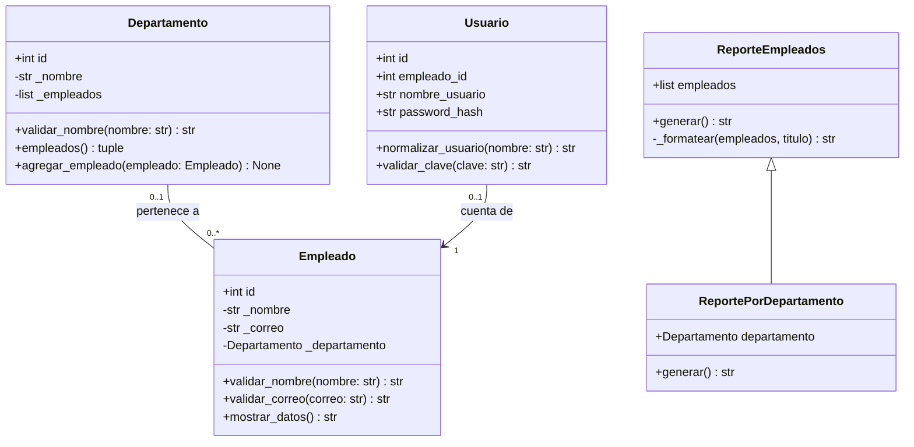

# UML base v1 · EcoTech

Diagrama de clases del proyecto implementado.

## Decisiones de diseño

1. **Empleado–Departamento es una asociación:** un departamento tiene 0 o muchos empleados y un empleado pertenece a 0 o 1 departamento (puede estar sin asignar). En la BD se guarda como la FK `empleado.departamento_id`.
2. **Usuario–Empleado es una asociación, no herencia:** una cuenta no *es* un empleado, pertenece a uno. Cada empleado tiene como máximo una cuenta (`empleado_id` es `UNIQUE`).
3. **Herencia solo en los reportes:** `ReportePorDepartamento` *es un* `ReporteEmpleados`; reutiliza el constructor con `super()` y redefine `generar()` (polimorfismo).
4. **Encapsulamiento:** nombre, correo y departamento son privados y se modifican mediante propiedades que validan. La colección `_empleados` solo cambia con `agregar_empleado()`.
5. **La contraseña no es un atributo:** `Usuario` guarda solo `password_hash` (bcrypt).

## Correcciones respecto del borrador

- Se descartó la herencia entre Empleado y Departamento: no se cumple "es un".
- La multiplicidad 0..1 del lado de Departamento permite empleados sin asignar.

